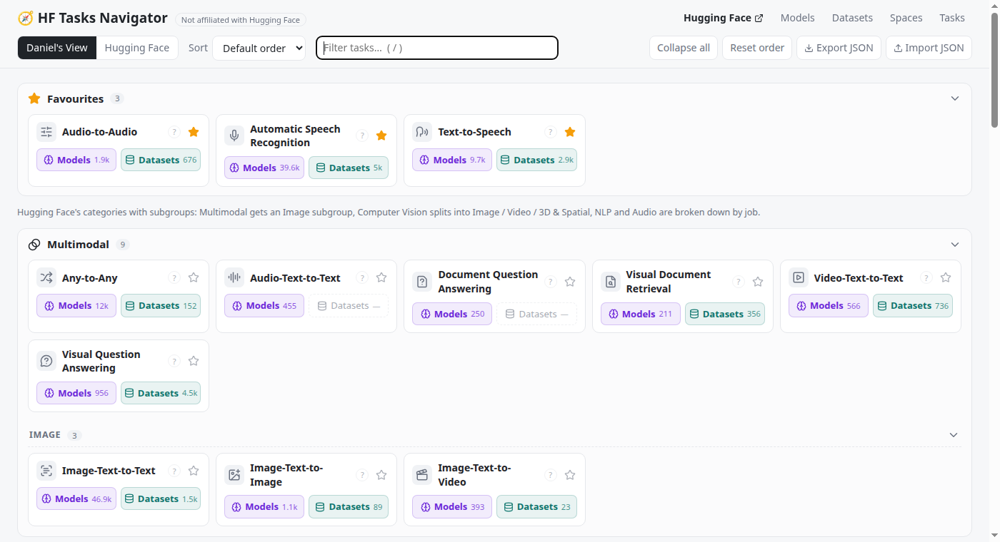

# HF Tasks Navigator



A single, self-contained HTML page (bookmark it) listing every Hugging Face Hub task, each with a **Models** and a
**Datasets** button that land straight on the filtered lists instead of the [huggingface.co/tasks](https://huggingface.co/tasks)
explainer pages:

- Models: `https://huggingface.co/models?pipeline_tag=<task>`
- Datasets: `https://huggingface.co/datasets?task_categories=task_categories:<task>`

**Unofficial. Not affiliated with or endorsed by Hugging Face.**

## Features

- **Two view presets** (toggle at the top, remembered):
  - **Daniel's View** is the default; see below.
  - **Hugging Face**: categories and order exactly as on [huggingface.co/tasks](https://huggingface.co/tasks), the
    source of truth for the classification. Tasks that appear only on /models (e.g. Text-to-Audio, Voice Activity
    Detection, Time Series Forecasting) are appended to their API category.
  - **Daniel's View** (default): the same top-level categories with subgroups: Multimodal → Image (Image-Text-to-Text, -to-Image, -to-Video); Computer Vision → Image / Video / 3D & Spatial;
    NLP → Classification / Generation / Embeddings & Retrieval / Question Answering; Audio → Speech-to-Text (ASR, VAD) /
    Audio Generation (TTS, text-to-audio) / Audio Classification, with Audio-to-Audio at the top level.
    Defined in [`views/daniels-view.json`](views/daniels-view.json).
- **Accordions** per group and subgroup; collapsed state is remembered. Expand/collapse all.
- **Custom category order**: hover a category or subgroup header for ↑/↓ buttons; order is saved per view.
  **Reset order** restores the current view's default.
- **Sort** within each group: default order, A–Z, or most models first.
- **Favourites**: click the ☆ on any task card; starred tasks show in a Favourites section at the top.
- **Settings in localStorage, portable as JSON**: everything (view, sort, favourites, category order, collapsed
  groups) is stored per browser and per file location. **Export JSON** downloads `hf-tasks-navigator-settings.json`;
  **Import JSON** loads one on another device (replaces settings).
- **Models** buttons are violet with a brain icon, **Datasets** buttons teal with a database icon; a dashed grey
  button means no matching tag. Every link opens in a new tab.
- Responsive: full toolbar on desktop, wrapped controls on tablet, single-column cards on phones.
- Icons per task and category ([Lucide](https://lucide.dev), ISC), inlined as an SVG sprite.
- Filter box (`/` to focus, `Esc` to clear), light/dark follows the system, quick links to Hugging Face, /models,
  /datasets, /spaces and /tasks.

A greyed `—` button means the Hub has no matching tag on that side (e.g. no dataset category for Keypoint Detection).
Blank counts are where the upstream count check was rate-limited; the link still works.

## Use

```bash
scripts/install.sh   # copy hf-launch.html to ~/launchers/hf-launch.html (override dir: HF_LAUNCH_DIR=...)
scripts/open.sh      # open it in the default browser (installs first if missing), then bookmark it
```

`hf-launch.html` is committed, so installing needs no Node.

## Settings file format

```json
{ "app": "hf-tasks-navigator", "schema": 2, "exported": "2026-11-14T12:00:00.000Z",
  "settings": {
    "view": "daniel",
    "sort": "default",
    "favourites": ["automatic-speech-recognition", "text-to-speech"],
    "collapsed": ["daniel:Multimodal"],
    "order": { "daniel": ["daniel:Audio", "daniel:Tabular"], "daniel:Audio": ["daniel:Audio:Speech-to-Text"] } } }
```

- `view`: `daniel` or `hf`. `sort`: `default`, `az` or `models`.
- `favourites`: Hub task ids (`pipeline_tag` values).
- `collapsed` / `order` keys: `<view>:<Category>[:<Subgroup>]`. `order` maps a parent (`<view>` for categories,
  `<view>:<Category>` for subgroups) to its children in order; children not listed keep their default position after.
- Import of a schema-2 file replaces all settings. A schema-1 file (`{"favourites": [...]}`) or a bare array of ids
  only merges favourites.
- localStorage keys: `hfnav.view`, `hfnav.sort`, `hfnav.favourites`, `hfnav.closed`, `hfnav.order`.

## Build

Astro 7, single page, CSS and scripts inlined so the output works from `file://`.

```bash
pnpm install
pnpm build                       # astro build, then copies dist/index.html -> hf-launch.html
uv run scripts/refresh-data.py   # optional: refresh data/ first
```

Astro 7 needs Node ≥ 22.23.4; `.npmrc` sets `use-node-version=22.23.4` so pnpm fetches it for the scripts.

| Path | What |
|---|---|
| `data/tasks.json` | Task ids, labels, URLs, counts: trimmed copy of [HF-URLs](https://github.com/danielrosehill/HF-URLs) `data/hf-urls.json` |
| `data/hf-tasks-order.json` | Category + task order scraped from huggingface.co/tasks (server-rendered `<h2>` + `/tasks/<id>` links) |
| `views/daniels-view.json` | Daniel's View grouping; `groups[].tasks` (top level) and `groups[].subgroups[].tasks` |
| `src/lib/views.ts` | Builds both presets; any task a view doesn't place goes to "Not yet classified" |
| `src/lib/icons.ts` | Task id → Lucide icon name |
| `src/pages/index.astro` | Page, styles and client script |

Adding a view: write another `views/*.json` in the same shape and add it to `views` in `src/lib/views.ts`.
